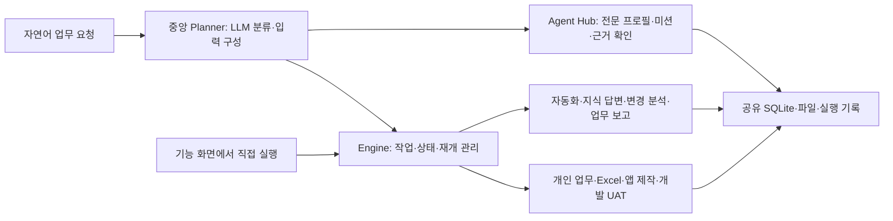

# Workmate v0.6 · 개인비서와 업무 실행 플랫폼

일을 기억하고 다음 행동을 챙기는 개인 업무 플랫폼입니다. 온라인 워크스페이스와 Windows 설치형으로 사용할 수 있습니다. 업무 요청을 기억하고, Excel을 검사하고, 실제 저장되는 업무앱을 만들고, 변경 사항을 브라우저에서 검증해 결과물까지 남깁니다. 대화·작업 상태·파일·앱 데이터가 하나의 워크스페이스에 연결됩니다.

[워크스페이스 열기](https://workmate-otpo.onrender.com/) · [서비스 소개와 영상](https://sagytic.github.io/workmate/) · [설치·개인 API 사용 안내](https://sagytic.github.io/workmate/Workmate_사용안내.html) · [Windows Mini와 실행 패키지](https://github.com/Sagytic/workmate/releases/tag/v0.6.0)

## v0.6 에이전트 스튜디오

네 가지 전문 프로필을 기존 여덟 가지 업무 도구와 함께 사용합니다. 왼쪽 **에이전트 스튜디오**에서 직접 실행하거나 업무 요청에서 전문 분야를 지정합니다.

| 전문 분야 | 처리하는 일 |
|---|---|
| 회의 후속 정리 | 명시된 결정·담당자·기한과 후속 업무, 기억 후보 |
| 의사결정 브리프 | 대안의 장점·비용, 판단 기준과 추가 확인 질문 |
| 프로젝트 레이더 | 실제 업무의 기한 경과·보완 대기·담당 미지정 확인 |
| 주간 회고 | 최근 7일의 실제 완료 기록, 현재 미완료 업무, 개인 기록과 다음 행동 |

**에이전트 만들기**에서 이름·전문 분야·지침을 저장하고, 프로젝트·참고 문서(최대 20개)·업무 기억 사용 여부를 지정합니다. 프로필을 복제하거나 보관할 수 있으며 이전 실행은 당시 프로필과 자료 사본을 유지합니다. 프로젝트를 지정한 경우 같은 프로젝트 자료와 업무만 읽습니다. 문서를 명시하지 않으면 선택한 프로젝트 자료를 사용합니다. 프로젝트와 문서가 모두 비어 있으면 회의·의사결정은 요청문을, 레이더·회고는 전체 업무 기록을 사용합니다. 기억은 선택한 경우에만 포함합니다.

**협업 미션**은 같은 요청을 최대 4개 프로필에 독립적으로 실행합니다. 실제 자식 실행의 대기·진행·완료·실패를 집계하며 각 결과를 따로 확인합니다. 하나의 실행은 `자료 수집 → 전문 분석 → 근거 확인 → 결과 전달` 단계입니다. 인용 대조는 원문 문자열 일치를 확인하며 요약·해석의 의미상 정확성까지 판정하지 않습니다.

결과에서 필요한 **후속 업무와 기억을 선택해 저장**합니다. 동일 항목은 중복 등록하지 않고, 기존 기억과 다른 값은 덮어쓰지 않고 충돌로 알립니다. 결과·요청·근거를 담은 HTML을 내려받을 수 있습니다. API 연결 시 선택한 자료와 지침을 실제 모델에 전달하며, 연결이 없으면 명시된 문장 추출과 업무 기록 집계로 실행합니다. 모델 오류가 발생하면 실패로 표시하며 성공한 규칙 분석으로 바꾸지 않습니다.

```text
결정: 월말 결산 전환은 단계적으로 진행한다.
할 일: 데이터 이관 검증표 정리 | 담당: 김지민 | 기한: 2026-10-28 | 우선: 높음
대안: 단계별 오픈 | 장점: 위험 분산 | 비용: 운영 2회
기억: 고객사 자료 공유 원칙 = 발송 전에 숫자와 근거를 함께 확인한다.
```

날짜만 명시된 기한은 날짜로 보존하며 다음 날부터 기한 경과로 집계합니다. 기한이나 담당자가 원문에 없으면 비워 둡니다. 실행 상태가 완료되었다고 후속 업무까지 완료 처리하지 않습니다. 에이전트가 외부 메일·웹사이트를 자율 조작하거나 새 미션을 계속 만드는 구조는 아닙니다.

[에이전트 활용 영상](https://sagytic.github.io/workmate/Workmate_에이전트_활용흐름.mp4) · [사용 안내](https://sagytic.github.io/workmate/Workmate_사용안내.html#agent-studio)

참고한 공식 설계 자료: [Dot 작업과 기억](https://learn.chatgpt.com/docs/dots/tasks-and-memory), [Muse 개인 에이전트](https://about.fb.com/news/2026/09/introducing-muse-personal-ai-agent/), [Notion Custom Agents](https://www.notion.com/help/custom-agents). 개인 맥락·목표의 후속 행동·프로필별 지침과 자료 범위에 관한 설계를 참고했으며 제품 연동을 뜻하지 않습니다. 확인일 2026-10-23.

## 개인 LLM API 연결

화면 오른쪽 위 연결 배지 → **개인 API 연결**에서 API 기본 주소, 개인 API 키, 모델 ID를 입력하고 **연결 확인 후 적용**을 누릅니다. 연결에 성공한 설정만 적용합니다. 설치형의 **이 PC에 저장**은 `.env`에 저장하며, 이 파일은 GitHub와 자료 묶음에서 제외합니다. 저장하지 않으면 서버가 종료될 때 연결을 다시 설정합니다.

| 제공자 | 기본 주소 | 입력 안내 |
|---|---|---|
| OpenAI | `https://api.openai.com/v1` | 개인 API 키와 사용 가능한 모델 ID |
| OpenRouter | `https://openrouter.ai/api/v1` | 개인 API 키와 `제공자/모델` ID |
| Ollama (설치형) | `http://localhost:11434/v1` | 키 `ollama`, 내려받은 모델 이름 |
| 개인·사내 endpoint (설치형) | 제공자의 HTTPS 기본 주소 | OpenAI 호환 Bearer 키와 모델 ID |

`/chat/completions`, Bearer 인증, `response_format: json_object`를 지원해야 합니다. Azure·Anthropic 원본 API는 호환 게이트웨이가 필요합니다. 401은 키, 402는 잔액·한도, 404는 주소·모델, 429는 요청 제한을 확인합니다. API 사용료는 본인의 제공자 계정에 청구될 수 있으며 무료 호스팅과 별개입니다.

직접 설정하려면 `.env.example`을 `.env`로 복사하고 `WORKMATE_LLM_BASE_URL`, `WORKMATE_LLM_API_KEY`, `WORKMATE_LLM_MODEL`을 채운 뒤 서버를 다시 시작합니다. OS 환경 변수가 파일보다 우선합니다. 현재 연결 해제 버튼은 메모리 연결만 해제하며, 저장한 파일까지 없애려면 `.env`의 값을 지웁니다.

API 없이 Excel 검사·사본 복원, 업무·자료 관리, 기한 기반 계획·집중, 기본 업무앱, 지원 항목의 UAT 화면 검증과 규칙 기반 자료 처리 기능을 실행할 수 있습니다. 전문 프로필의 명시 문장 추출·업무 집계·협업 미션도 API 없이 실행할 수 있습니다. 자유로운 요청 해석·맥락 브리핑·프로필 지침을 반영한 분석·요구사항 기반 앱 구성에는 API를 연결하세요.

## Windows Mini

독립 Windows 앱입니다. 브라우저를 닫아도 바탕화면 모아와 트레이가 남습니다. 모아 클릭 또는 `Ctrl + Alt + Space`로 대화를 열고, 상단 점을 끌어 위치를 바꿉니다. 설정에서 항상 위 표시, 말풍선 알림, Windows 로그인 시 시작을 선택할 수 있습니다. 로그인 시 시작은 기본으로 꺼져 있습니다. 서버가 꺼져 있으면 Mini가 함께 시작하며, 기존 서버가 있으면 재사용합니다. 트레이 메뉴의 종료로 끝냅니다.

배포된 Windows 실행 파일을 사용하거나 다음 명령으로 개발 실행합니다. 다른 PC에는 아래 Python 의존성 설치를 먼저 진행하세요.

```powershell
cd desktop
npm ci
npm start
```

## 온라인 실행

`Dockerfile`과 `render.yaml`은 Render Free 웹 서비스용입니다. `backend.cloud:app`을 단일 프로세스로 실행하며 방문자별 SQLite·파일·API 키를 분리합니다. 운영자 `.env`와 개인 작업 DB는 이미지에 포함하지 않습니다. 방문자가 입력한 키는 해당 세션의 서버 메모리에만 보관합니다. 공개 서버의 API 목적지는 지정한 공개 제공자로 제한하며 사내·개인 endpoint는 설치형에서 사용합니다.

접속자 수 8명, 방문 세션 비활성 1시간 제한을 적용합니다. 무료 호스팅의 재시작·재배포·휴면과 세션 정리에 따라 데이터가 사라질 수 있으므로 필요한 산출물을 내려받으세요. Render Free는 미사용 15분 후 휴면하며 다음 접속 때 다시 시작합니다. 기한 알림과 주기 작업은 서버가 실행 중일 때 수행합니다. [Render 무료 요금제 설명](https://render.com/docs/free)

## 실행

이 개발 PC에는 실행 패키지와 화면 빌드가 준비되어 있습니다.

1. `start.cmd`를 실행합니다. 같은 서버가 이미 켜져 있으면 중복 실행하지 않습니다.
2. 브라우저에서 <http://127.0.0.1:8765>를 엽니다.
3. 종료할 때 서버 창에서 `Ctrl+C`를 누릅니다. 앱·작업·기억은 SQLite에 보관됩니다.

다른 PC에서는 Python 3.11 이상과 Node.js 20.19 이상 또는 22.12 이상을 준비한 뒤 프로젝트 폴더에서 실행합니다.

```powershell
powershell -NoProfile -ExecutionPolicy Bypass -File .\setup.ps1
.\start.cmd
```

`setup.ps1`은 Python 가상환경, Python/Node 의존성, 화면 빌드를 준비합니다. 개발·UAT에는 실제 브라우저가 필요합니다. Edge 또는 Chrome이 없으면 프로젝트 폴더에서 `npx playwright install chromium`을 실행합니다.

**서버가 켜져 있어야 주기 자동화와 기한 알림이 실행됩니다.** 종료 중 놓친 모든 주기를 소급 실행하지 않습니다. 중단 당시 실행 중이던 작업은 재시작 후 실패로 표시하며, 결과를 확인한 뒤 다시 실행할 수 있습니다.

## v0.4 개인 비서와 티켓 결과서

- **모아:** 모든 웹 화면 오른쪽 아래에서 빠른 대화와 업무 알림을 제공합니다. `Ctrl+Shift+Space`로 열고, 확장 버튼으로 별도 작은 브라우저 창을 엽니다. 이름, 알림 잠시 끄기, 30분 미루기를 설정할 수 있습니다. v0.6의 Windows Mini는 위 설명과 같이 브라우저 밖에서도 실행합니다.
- **오늘 계획:** 프로젝트와 가용 시간 안에서 기한·우선순위·보완 대기를 기준으로 업무를 배치합니다. 시간 블록의 완료, 업무 상세 연결, 집중 시작, 캘린더 가져오기용 ICS 다운로드를 제공합니다. 규칙 기반 배치이며 외부 캘린더의 빈 시간을 읽지는 않습니다.
- **집중 시간:** 업무별 타이머 시작·일시 정지·재개·완료와 집중 기록을 저장합니다. 집중 중에는 말풍선 알림이 잠시 멈춥니다. 타이머 완료와 실제 업무 완료는 별도로 관리합니다.
- **개발 티켓 · 결과서:** 앱, 요구사항, 요청자·메일, 개발 담당자, 연결 개발 작업과 인수 기준을 저장합니다. 티켓을 선택하면 현재 앱 소스 사본을 실제 브라우저에서 실행하고 항목별 화면 증거를 만듭니다.
- **UAT 전달:** 실행 날짜·담당자·요청자·앱 버전·소스 해시, 요구사항 연결, 절차·기대/실제 결과·판정·캡처를 HTML 결과서에 넣습니다. 화면이 포함된 HTML, PNG, ZIP, 결과서가 첨부된 `.eml`을 받습니다. EML은 메일 앱에서 확인 후 전송합니다. 자동 메일 발송과 현업 자동 승인은 수행하지 않습니다.
- **인수 기록:** 현업의 인수·조건부 인수·반려와 의견을 별도 기록합니다. 실행 당시 티켓과 소스는 고정해 보관하며, 나중에 티켓을 수정해도 과거 결과서가 바뀌지 않습니다.

UAT 양식은 European Commission PM²의 Deliverables Acceptance Plan/Checklist 구조를 참고해 실행 증거에 맞게 작성했습니다. 회사 지정 양식을 업로드해 자동 변환하는 기능은 포함하지 않습니다. 기준을 선택했지만 실제 검증 항목으로 대응하지 못하면 자동 통과로 처리하지 않습니다.

### 반영한 공식 해외 참고 자료

- [Raycast Focus](https://manual.raycast.com/focus): 빠른 호출과 집중 시간, 알림을 줄이는 흐름.
- [Motion AI Task Manager](https://www.usemotion.com/features/ai-task-manager): 기한·우선순위와 가용 시간의 연결.
- [Atlassian 작업 항목과 에이전트](https://support.atlassian.com/jira-software-cloud/docs/collaborate-on-work-items-with-ai-agents/): 티켓에 요구사항·실행·검토 맥락을 연결.
- [European Commission PM² 산출물](https://pm2.europa.eu/pm2-artefacts_en): 산출물 인수 계획과 점검 구조.

자료 확인일 2026-10-22. 설계 패턴을 참고했으며 해당 서비스와의 제휴나 연결을 의미하지 않습니다.

### v0.4 실행 검증

- Python 회귀 **113개 통과**, 브라우저 선택 항목 1개 제외. 해당 실제 브라우저 항목을 별도로 실행해 **1개 통과**했습니다. 외부 라이브러리 경고 1건이 있습니다.
- 8개 역할의 실제 서버 실행, 문서 근거 발췌, 앱 생성·변경, 자동화 대기 후 보완·등록, Excel 사본 복원과 다운로드를 확인했습니다.
- 모아 실제 API 대화·기억, 오늘 계획과 ICS, 집중 시작·일시 정지·재개·완료, 작은 창과 업무 링크를 확인했습니다.
- 촬영한 구매 요청 티켓은 **11개 항목 통과·11장 캡처**입니다. 결과서와 EML 첨부를 확인했고 현업 인수 결정은 별도 상태로 남습니다.
- 실제 촬영 화면, 자막이 합쳐진 MP4, 소개 HTML, A4 소개와 사용 안내를 별도 자료 모음에 담았습니다.
- 전체 응답 이력이 포함된 내부 검증 파일은 배포에서 제외하고 요약 기록을 `verification/v0.4/summary.json`에 보관합니다.

## 여덟 가지 업무 도구

| 도구 | 현재 구현된 기능 |
| --- | --- |
| 근거 기반 업무 지식 | 프로젝트 문서 질의응답, 문단 ID와 실제 원문 발췌 확인, HTML·JSON·TXT 보고서 |
| 변경 영향 분석 | 문서 두 버전의 원문 변경 비교, 모델의 영향 해석 구분, 후속 업무 선택 등록·중복 방지 |
| 업무 보고 | 실제 저장 업무로 주간보고·인수인계·회의 준비, 완료 시각에 근거한 실적·기한 초과·대기 집계 |
| 개인 업무비서 | 자연어 요청 분류·위임, 업무 기억 저장·수정·삭제, 실제 작업과 기한에 근거한 브리핑, 개인 할 일 추가·완료 확인, 기한 알림 |
| Excel 검증 | 기준 파일과 수정본 비교, 유일 ID에 따른 행 대응, 수식 변경·누락·상수화·깨진 참조, 지원 업무 규칙과 데이터 유효성 규칙 변경 검사, 최대 10개 수정본 일괄 검사, 검토 후 사본 복원 |
| 업무앱 제작 | 설명에 따른 입력 항목과 규칙 구성, 실제 생성 HTML, 레코드 등록·조회·수정·삭제, 검색·상태 필터, CSV 내보내기, 재접속 후 데이터 유지 |
| 개발·UAT | 생성한 업무앱의 지원 범위 내 변경, 소스 diff·SHA-256, 결정적 규칙 리뷰, 실제 브라우저 검증·PNG 캡처, 티켓별 HTML UAT 결과서와 첨부 메일 파일 |
| 업무 자동화 | Excel 검사 → 확인할 항목에서 보완 대기 → 결과 등록 절차 저장, 수동·플랫폼 파일 업로드·주기 실행, 수정 사본·보완 파일·추가 등록값으로 같은 작업 재개 |

공통 화면에서 작업 검색·상태 필터·기한/우선순위 정렬, 제목·기한·우선순위 편집, 보관/보관 해제, 재실행, 실행 기록과 산출물 확인을 제공합니다. 재실행은 이전 작업을 보존하고 연결된 새 작업을 만듭니다. 보완 후 재개는 같은 작업의 새 시도로 기록합니다.

`업무 요청`에는 대화와 관련 작업 링크가 남습니다. `파일 보관함`에 올린 파일은 검사와 자동화에서 다시 선택할 수 있습니다. 작업의 **전체 다운로드**는 실행 정보와 등록된 산출물을 ZIP으로 묶으며, UAT HTML과 실제 화면의 상대 경로를 유지합니다.

## 업무 공간 사용하기

기본 화면은 다크 모드입니다. 상단의 화면 테마 전환 버튼으로 밝은 화면을 선택하면 다음 접속에도 유지됩니다. 생성 업무앱에도 같은 설정을 적용하며 연결 상태는 **API 연결됨**으로 표시합니다.

**예제 모음 → 예제 준비**를 누르면 5개 프로젝트, 업무 40건, 문서 10건, 업무앱 4개와 레코드 48건, 실행 예제 16개를 준비합니다. 기존 데이터와 사용자가 수정한 샘플은 덮어쓰지 않으며 다시 눌러도 같은 데이터가 중복 생성되지 않습니다. 샘플 자동화 3개는 기본적으로 꺼져 있습니다.

- **홈:** 프로젝트 진척·위험, 목록·칸반·주간 일정, 담당자·프로젝트·상태 필터, 최근 결과물, 추천 예제.
- **자료실:** 텍스트 작성·수정·삭제, TXT/MD 업로드와 다운로드, 프로젝트 분류. PDF·DOCX 추출은 아직 포함하지 않습니다.
- **업무 도구:** 문서 질문, 변경 분석, 세 가지 보고서. 결과의 후속 업무를 선택해 실제 할 일로 등록합니다.
- **전체 검색:** Ctrl+K로 업무·문서·업무앱·앱 레코드·업무 기억을 찾습니다.
- **업무 상세:** 담당자·프로젝트·태그·설명·기한 편집, 수동 업무 상태 변경, 메모 작성·삭제. 실행 에이전트의 완료 여부는 실행 결과가 결정합니다.

`data/examples/`에는 다시 올려볼 수 있는 요구사항 전후본, 정산 가이드 전후본, 견적·협의·인수검수 자료가 있습니다. 예제 화면의 **예상 결과**와 실제 산출물을 비교해 보세요. 샘플 준비 자체는 LLM을 호출하지 않으며, LLM 표시가 붙은 예제를 실행하면 모델 사용량이 발생합니다.

## 에이전트 구조: 중앙 라우팅과 역할별 실행

현재 구조는 **중앙 계획·분류 모듈 + 작업 실행기 + 8개 업무 도구 + 설정 가능한 4개 전문 분야**입니다. 중앙 LLM은 자연어 요청을 허용된 업무 종류와 입력으로 바꾸고, Python 실행기가 작업을 배정해 상태·파일·재시도를 관리합니다. 화면에서 기능을 직접 선택하면 중앙 분류를 거치지 않고 해당 모듈을 실행합니다.



**모든 하위 에이전트가 독립적인 ReAct 루프를 수행하는 구조는 아닙니다.** Excel은 결정적 검사 규칙, 자동화는 정해진 검사→보완→등록 흐름입니다. 앱 제작·변경은 LLM의 구조화 계획과 검증된 코드 템플릿을 사용합니다. 지식·분석·보고는 원문이나 작업 기록을 수집한 뒤 LLM 해석과 근거 검사를 수행합니다. 도구 결과를 관찰해 매 단계 새로운 도구를 자율 선택하는 범용 ReAct는 구현하지 않았습니다.

## 반영한 해외 제품 패턴

최신 자료 확인 기준은 2026-10-22입니다. 아래는 설계 참고 사례이며 외부 제품과 연결한 것은 아닙니다.

| 공식 자료 | 참고한 패턴 | 이번 구현 |
| --- | --- | --- |
| [Notion 3.8 · 2026-10-13](https://www.notion.com/releases/2026-10-13) | 에이전트 사이의 업무 맥락 공유 | 프로젝트 자료실, 문단 근거, 분석에서 할 일로 연결 |
| [Atlassian Rovo Jira Delivery](https://support.atlassian.com/rovo/docs/work-with-jira-delivery-agent/) | 지연·정체·차단 업무를 작업 기록으로 파악하고 보고 | 프로젝트 위험 현황, 주간보고·인수인계·회의 준비 |
| [Asana AI Studio 공식 교육](https://forum.asana.com/t/academy-training-getting-started-with-ai-studio/1123505) | 요청 분류와 누락 정보 확인, 후속 처리 흐름 | 변경 분석의 확인 질문과 선택 업무 등록, 재사용 예제 |

## 실제 LLM 연결과 규칙 기반 모드

이 개발환경에서는 **OpenRouter의 `deepseek/deepseek-v4.1-flash` 실제 연결을 확인했습니다.** 상단 연결 상태를 열고 **연결 테스트**를 누르면 소량의 실제 모델 요청으로 현재 연결을 진단합니다. 설정 존재 여부와 실제 연결 성공을 구분해 표시합니다.

다른 환경에서 연결하려면 프로젝트의 `.env` 또는 서버 환경변수에 아래 필수 세 값과 선택 설정을 넣고 서버를 재시작합니다. 키는 서버에만 보관하며 브라우저로 보내지 않습니다.

```dotenv
WORKMATE_LLM_BASE_URL=https://openrouter.ai/api/v1
WORKMATE_LLM_API_KEY=YOUR_KEY
WORKMATE_LLM_MODEL=deepseek/deepseek-v4.1-flash
WORKMATE_LLM_REASONING_EFFORT=none
```

마지막 줄은 선택 설정이며 현재 모델에 권장합니다. 기본 추론이 출력 토큰 예산을 소모해 계획 JSON이 비는 현상을 피하기 위한 설정으로, OpenRouter 요청에만 전달합니다.

연결 서버는 OpenAI 호환 `POST /chat/completions`와 JSON 응답 모드를 지원해야 합니다. HTTP 클라이언트는 `ssl.create_default_context()`로 시스템 신뢰 루트를 사용하며 TLS 인증서 검증을 유지합니다. API 오류는 실패로 표시하고 규칙 기반 결과로 조용히 대체하지 않습니다.

세 설정이 모두 갖춰지지 않으면 **규칙 기반 모드**입니다. 요청 분류와 기본 앱 구성을 정해진 규칙으로 처리합니다. 이 경우에도 Excel 검사, 데이터 저장, 생성 HTML 실행, 브라우저 테스트와 캡처는 실제로 수행합니다. 자유로운 사용자 정의 필드 제안은 실제 LLM 연결 모드에서 지원합니다.

LLM은 의도와 허용된 앱 스키마를 제안합니다. 임의의 모델 생성 코드를 호스트에서 실행하지 않습니다. 대화 요청, 최근 대화, 저장된 기억, 앱 이름, 작업 요약·기한, 업로드 파일명, 지식·분석·보고에 선택된 문서 본문과 작업 기록 등 맥락은 연결된 외부 모델로 전달될 수 있습니다. 현재 코드가 Excel 원본 바이트나 전체 셀 내용을 모델로 전송하지는 않습니다. 제공된 예제로 기능을 확인할 수 있습니다.

## 권장 실행

1. **기억과 업무 진행:** “기억해줘 보고 형식: 결론과 확인할 항목을 먼저 정리”를 입력합니다. 오늘의 업무에서 할 일과 기한을 추가하고, 업무 요청에서 “오늘 업무 브리핑”을 요청합니다.
2. **업무앱 제작:** “고객 요청을 관리하는 앱. 담당자, 기한, 상태 외에 고객사 텍스트, 예상 금액 숫자 0 이상, 고객 이메일을 추가해줘”로 앱을 만듭니다. 생성 앱에서 저장·수정·검색·CSV를 확인합니다.
3. **개발·UAT:** 만든 앱을 선택하고 “완료 시 완료 메모 필수, 담당자와 기한도 필수로 해줘”를 실행합니다. 실제 테스트 결과, PNG, `change.diff`, `uat-report.html`을 확인합니다. 통과한 변경만 앱에 적용됩니다.
4. **Excel 일괄 검증:** 기준 원본과 오류 수정본·정상 보완본·행 순서 변경본을 함께 선택합니다. 파일별 발견 사항과 검사 범위를 확인하고 CSV/HTML을 내려받습니다. 복원은 오류 수정본을 단일 검사로 연 뒤 명확한 수식만 사본에 적용합니다.
5. **자동화와 사람 입력:** Excel 검사와 결과 등록을 저장해 오류 수정본으로 실행합니다. 확인 대기에서 정상 보완본으로 재개합니다. 대상 앱에 추가 필수 항목이 있으면 보완 입력 화면에서 값을 채웁니다. 동일 자동화·동일 앱·동일 파일 내용의 결과 등록은 중복 생성하지 않습니다.
6. **반복 실행과 결과물:** 자동화를 주기 실행 또는 새 업로드 실행으로 설정합니다. 사용 중/일시 정지를 전환하고 작업 상세에서 전체 결과 ZIP을 받습니다. 기한 업무의 알림과 작업 보관도 확인합니다.

## 업무앱의 지원 범위

기본 5개 필드는 업무명(`title`), 담당자(`owner`), 기한(`due_date`), 상태(`status`), 완료 메모(`completion_note`)입니다. 기본 필드에 사용자 정의 필드를 최대 8개 더해 **총 13개**까지 구성합니다. 기본 필드는 삭제하지 않으며 업무명은 필수입니다.

지원 입력 형식은 텍스트, 여러 줄 텍스트, 숫자, 날짜, 선택 목록, 이메일, 체크박스입니다. 필수 여부, 숫자 최솟값/최댓값, 선택 목록을 설정할 수 있습니다. 완료 메모 필수와 과거 기한 금지도 지원합니다. 생성 화면과 API 양쪽에서 입력을 검증합니다. 개발 변경으로 항목을 추가하거나 제약을 바꿔도 기존 데이터는 유지되며, 기존 레코드를 수정할 때 새 규칙을 적용합니다.

이 버전은 **구조화된 CRUD 업무앱 템플릿**입니다. 임의 저장소의 범용 코딩, 자유로운 화면/서버 코드 생성, 기존 ERP나 금융 시스템 수정 기능은 포함하지 않습니다. 자동화 또한 위의 Excel 검사·결과 등록 절차로 제한되며, 임의 사이트 조작을 녹화·재생하는 범용 RPA가 아닙니다.

## Excel 검사와 복원

**종합 예제는 `data/examples/excel_showcase/Excel_검증_기준본.xlsx`와 `Excel_검증_수정본.xlsx` 두 파일입니다.** Excel 검증 또는 예제 모음 화면에서 파일과 사례 안내를 내려받을 수 있습니다. 파일마다 14개 시트가 있으며 수식 손상, 필수값·숫자·상태, ID 대응, 행·시트 추가/삭제, 열 구조, 데이터 유효성 규칙, 미지원 수식, CSV·HTML 내보내기까지 59개 사례를 확인합니다.

제공 파일의 예상 결과는 **오류 26건·검토 23건·변경 45건·복원 가능한 수식 5개**입니다. 수식을 사본에 복원하면 오류 22건·검토 21건·변경 40건이 남습니다. 데이터 오류와 검사 범위 밖 수식이 남는 것이 정상이며, 원본 두 파일은 그대로 유지됩니다. 사례별 시트·셀·판정은 `Excel_검증_예제_안내.html`과 `verified-case-matrix.json`에서 확인합니다.

`data/fixtures/`에는 기본 업무 예제를 제공합니다.

| 파일 | 목적 |
| --- | --- |
| `baseline.xlsx` | 기준 원본 |
| `changed.xlsx` | 수식·필수값·중복 ID·허용 상태·유효성 규칙 등에 의도적으로 오류를 넣은 수정본 |
| `clean.xlsx` | 정상 보완본 |
| `reordered.xlsx` | 유일 ID를 유지한 행 순서 변경본 |
| `ground_truth.json` | 데이터의 예상 발견 사항 |

업로드는 파일당 10 MiB 이하의 `.xlsx`만 받으며 매크로 파일은 지원하지 않습니다. 업로드 시 압축 해제 크기 50 MiB, ZIP 항목 2,000개를 제한하고 검사 범위는 통합문서당 20만 셀 이내입니다. 일괄 검사는 **기준 파일 1개와 수정본 1~10개**를 각각 비교합니다. 수정본끼리 병합하거나 서로 비교하지 않습니다. 일부 파일이 실패하면 해당 파일은 미검증으로 표시합니다.

Excel 검사는 **재계산 없는 정적 검사**입니다. 같은 시트의 유일 ID로 행을 맞추고 동일 헤더로 값을 비교합니다. 업무 규칙은 `id/title/owner/quantity/unit_price/total/status`에 대응하는 헤더가 모두 있을 때만 적용합니다. 한글 별칭으로 고유번호·제목·담당자·수량·단가·합계·상태 등을 지원합니다. 필수값, 중복 ID, 숫자·음수, 허용 상태와 기준 대비 데이터 유효성 규칙 변경을 확인합니다. 모든 사용자 정의 유효성 수식을 계산하는 것은 아닙니다.

수식은 같은 행의 상대 행 참조와 제한된 함수(`SUM`, `PRODUCT`, `ROUND` 계열, `ABS`, `MIN`, `MAX`, `AVERAGE`, `IF`)를 분석합니다. 교차행·외부/이름 참조·배열 수식 등은 미검증으로 남깁니다. 저장된 오류와 깨진 참조를 찾지만, 계산 결과의 최신성·모든 순환 참조·업무상 정답을 보증하지 않습니다.

복원은 유일한 대응 ID, 동일 열 구조, 명확한 기준 수식이 있는 셀에 한정합니다. 원본을 덮어쓰지 않고 사본과 복원 로그를 만들고 다시 정적 검사합니다. 차트·외부 연결·피벗 등 보존을 보장하기 어려운 기능이 있으면 복원을 거절합니다. 일괄 자동 복원은 지원하지 않으므로 파일별 단일 검사에서 검토 후 실행합니다. 복원 사본은 Excel에서 열어 재계산하고 확인해야 합니다.

검사 산출물은 HTML 보고서, `inspection.json`, `findings.csv`, `changes.csv`입니다. CSV는 UTF-8 BOM 형식이며 수식으로 해석될 수 있는 텍스트를 이스케이프합니다.

## 테스트와 UAT 증거

개발·UAT는 변경 예정 HTML을 실제 브라우저에서 실행하고, 테스트한 소스의 SHA-256과 화면 PNG를 저장합니다. 필수 입력·조건부 완료 메모·사용자 정의 필드·CRUD·검색·필터·CSV 등을 스키마에 맞춰 검사합니다. 브라우저가 없거나 지원되는 변경이 없으면 통과로 처리하지 않습니다.

내장 UAT는 **격리된 메모리 API를 사용한 생성 화면 테스트**입니다. 운영 중인 앱 DB에 테스트 레코드를 넣지 않습니다. `test_scope`와 보고서에서 이 범위를 명시하며, 실제 플랫폼 API와 SQLite를 통한 통합 검증과 구분합니다. 코드 리뷰는 결정적 템플릿 규칙 검사이며 독립 AI 코드 리뷰가 아닙니다.

고정 양식 `uat-report.html`에는 요구사항, 사전조건, 절차·기대 결과·실제 결과·판정, 실제 화면과 소스 해시가 들어갑니다. 브라우저에서 인쇄하거나 PDF로 저장할 수 있습니다. DOCX 지정 양식 업로드/생성은 포함하지 않습니다. 자동 테스트 통과 후에도 **최종 현업 인수 승인은 사용자 판단**으로 남깁니다.

프로젝트 폴더에서 회귀 검사와 생성 앱 브라우저 검사를 실행합니다.

```powershell
$env:WORKMATE_BROWSER_TEST = '1'
$workmatePython = if (Test-Path '.venv\Scripts\python.exe') { '.\.venv\Scripts\python.exe' } else { 'python' }
& $workmatePython -m pytest -q
```

서버 실행 중 실제 API·DB·브라우저 통합 검사(작업과 레코드를 생성함):

```powershell
npm run test:browser
```

**v0.3 검증: 2026-10-22 완료.**

- Python 회귀 검사 **107개 통과**, 실제 브라우저 회귀 포함.
- 새 LLM 도구 3개, 근거 발췌 확인, 선택 후속 업무 중복 방지, 기본 Excel 예제 3종을 실제 서버에서 확인한 **7개 검사 통과**.
- Excel 종합 파일의 **59개 사례 일치**, 수식 **5개 사본 복원**, 원본 SHA-256 보존 확인. 실제 API를 통한 재검사와 산출물 14개 다운로드도 통과.
- 데스크톱과 모바일에서 11개 메뉴, 문서 편집·업로드·검색, 목록·칸반·일정, 근거 결과·후속 업무 등록을 확인했습니다.
- 상세 기록과 새 화면은 개발 PC와 이전 v0.3 배포본의 `verification/v0.3/`에 있습니다. 외부 라이브러리의 deprecation 경고 1건은 남아 있습니다.

**v0.2 기반 기능의 이전 검증 기록:**

- Python 회귀 검사 64개 통과(실제 브라우저 회귀 포함).
- 실제 서버 API·SQLite·브라우저 통합 11개 시나리오 통과.
- 실제 OpenRouter 연결·기억·기한 업무·대화 참조·기록 5개 확인 통과.
- 실제 LLM 사용자 정의 앱 생성 → 개발 → 12개 브라우저 UAT → Excel 검사 → 추가 입력 → 실제 등록 흐름 통과.
- 최대 13필드 생성앱 브라우저 20개 시나리오, 플랫폼 8개 화면과 모바일 메뉴 확인 통과.
- 브라우저 JavaScript 오류와 가로 넘침 0건. 외부 라이브러리의 deprecation 경고 1건은 남아 있습니다.

이전 실행 기록은 v0.2·v0.3 배포본과 개발 PC에 보관했습니다. v0.4 소스 묶음에는 현재 검증 요약만 포함합니다. 서로 다른 검증 범위이며 개수를 하나의 총 테스트 수로 합산하지 않습니다.

실제 LLM 검증을 다시 실행하려면 python scripts/smoke_llm.py 또는 python scripts/smoke_dynamic.py를 사용합니다. 실행 중인 서버와 API 사용량이 필요하며 작업을 생성합니다.

## 운영과 데이터

알림은 서버가 기한 임박/초과 여부를 확인해 앱 안에 저장합니다. 같은 작업·기한·단계의 알림을 중복 생성하지 않습니다. 메일·메신저·OS 푸시 발송은 연결하지 않았습니다.

주기 자동화는 1~10,080분 간격을 저장하며 서버가 약 15초마다 실행 시점을 확인합니다. 같은 자동화에 실행 중이거나 입력 대기 중인 작업이 있으면 주기 중복 실행을 건너뜁니다. 업로드 자동화는 **Workmate에 새 `.xlsx`가 올라오는 이벤트**를 사용하고 저장한 기준 파일과 비교합니다. 외부 폴더·메일함 감시는 포함하지 않습니다. 자동화 정의를 편집·정지·삭제해도 기존 실행 기록은 남습니다.

SQLite와 업로드·산출물은 로컬에 계속 저장되며 자동 보존 기간이나 자동 삭제 기능은 없습니다. 앱은 `127.0.0.1`에만 바인딩하는 단일 사용자 환경으로, 회사 시스템·인증·조직 권한·중앙 실행기는 미연결입니다. 회사 배포에는 해당 연동과 데이터 정책을 별도로 구현해야 합니다.

## 파일 구조

```text
backend/app.py               API, 업로드, 생성 앱·산출물 제공
backend/features.py          작업 관리, 내보내기, 연결 진단
backend/store.py             SQLite 영속 저장
backend/desk_api.py          자료실·프로젝트·검색·예제·후속 업무 API
backend/desk_agent.py        근거 기반 질의응답·변경 분석·업무 보고
backend/demo_data.py         기존 데이터를 보존하는 업무 예제 준비
backend/orchestrator.py      작업 상태·재개, 도구 위임, 주기·업로드·기한 처리
backend/llm.py               규칙 기반 분류와 실제 모델 연결·앱 스키마 계획
backend/excel_agent.py       Excel 정적 검사, 일괄 비교, CSV, 사본 복원
backend/builder.py           생성 앱, 제약 변경, 고정 양식 UAT
backend/builder_browser.cjs  실제 브라우저 검사·캡처
backend/companion.py         개인 비서 계획·집중·알림 API
backend/tickets.py           개발 티켓·화면 증거·결과서·EML
frontend/src/companion.jsx   모아·작은 창·오늘 계획
frontend/src/tickets.jsx     개발 티켓·실행 결과·인수 기록
frontend/                   React 화면
data/fixtures/              기본 XLSX와 예상 결과
data/examples/              문서·업무 예제와 Excel 종합 실행 파일
data/workmate.db             작업·대화·기억·앱·레코드·자동화 저장소
data/uploads/               업로드한 XLSX
data/artifacts/             작업·시도별 보고서, 소스, 실제 화면
scripts/smoke_browser.cjs    실제 서버 통합 검사
tests/                      회귀 검사
CONTRACT.md                 모듈·스키마·API 계약
```
